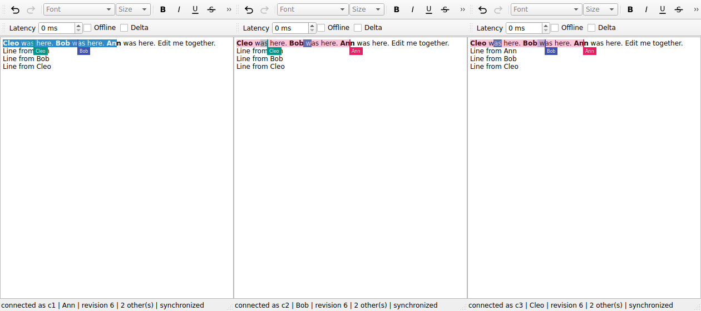

# quill-qt

A native Qt Widgets rich text editor that reads, writes and emits changes in
the [Quill Delta](https://quilljs.com/docs/delta) format, compatible with
[flutter_quill](https://pub.dev/packages/flutter_quill) and
[Quill](https://github.com/slab/quill).

**Status:** milestones M1 (skeleton), M2 (Delta core), M3 (Delta → QTextDocument), M4 (QTextDocument → Delta), M5 (editor widget), M6 (toolbar, demo), M7 (embeds), M8 (fidelity harness, CI), M9a (portability groundwork on Linux), M10 (rendering fidelity), M11 (large documents), M12 (collaboration) and M13 (image resize) done; M9 (native Windows and macOS) waits for those machines. See
[PLAN.md](PLAN.md) for the design and [plans/](plans/README.md) for the
milestone plans.

## Motivation

The goal is a working native QtWidgets Quill editor, ported from
flutter_quill and Quill (the ancestor of the idea). Both work with the same
internal format, the Delta. Linux comes first, then the other main desktop
platforms.

## Requirements

- Qt 6.4 or newer (Core, Gui, Widgets, Network; Test for the test-suite)
- CMake 3.21+, a C++17 compiler

On Ubuntu 24.04: `ci/install-deps-ubuntu.sh`.

## Using it in your project (vendored)

Copy or submodule this tree, then:

```cmake
add_subdirectory(third_party/quill-qt)
target_link_libraries(myapp PRIVATE QuillQt::Widgets)   # or QuillQt::Delta for the GUI-free core
```

When vendored, the demo and tests are not built unless you set
`QUILLQT_BUILD_DEMO=ON` or `QUILLQT_BUILD_TESTS=ON`. Libraries are static and
there are no install rules.

| Target | Contents | Qt modules |
|---|---|---|
| `QuillQt::Delta` | Delta model and operational transform | Core |
| `QuillQt::Widgets` | editor widget, toolbar, converters | Core, Gui, Widgets, Network |

## Delta core

`QuillQt::Delta` is a C++ port of [slab/delta](https://github.com/slab/delta)
5.1 with identical semantics, checked against the upstream test-suite and
fast-diff outputs (see [tools/oracle](tools/oracle/README.md)).

```cpp
#include <quill/Delta.h>

using quill::Delta;

Delta doc = *Delta::fromJson(QByteArray(R"([{"insert":"Hello\n"}])"));
Delta change = Delta().retain(5, {{"bold", true}});
Delta result = doc.compose(change);   // [{"insert":"Hello","attributes":{"bold":true}},{"insert":"\n"}]
Delta undo = change.invert(doc);      // [{"retain":5,"attributes":{"bold":null}}]
Delta mine = change.transform(Delta().insert("Hi "), /*priority*/ true);
QByteArray json = result.toJson();    // flutter_quill shape; JsonShape::OpsObject for Quill.js
```

Lengths and indices are UTF-16 code units, like JavaScript and
`QTextDocument`.

## Converting between Delta and QTextDocument

```cpp
#include <quill/DeltaDocument.h>

QTextEdit edit;
quill::LoadResult r = quill::DeltaDocument::load(edit.document(), delta);
for (const QString& w : r.warnings)   // unknown attributes etc., preserved anyway
    qWarning() << w;

// ... edit with QTextEdit or QTextCursor ...

quill::Delta out = quill::DeltaDocument::toDelta(edit.document());
QByteArray json = out.toJson();       // flutter_quill shape
```

Export keeps unknown attributes and original value spellings, and derives
attributes from edits made with plain Qt APIs (bold, colours, sizes, links,
headings, lists, alignment, images).

Styling follows flutter_quill's defaults, scaled to the document's font;
see `quill::StyleOptions` to change sizes, colours, indent width or the
colour dialect (flutter_quill or CSS). Vertical spacing is laid out the way
flutter_quill does it: consecutive lines with the same block attributes form
a block (list, indent, quote, code, alignment), with space above the block,
between its lines and padding inside code blocks. The gaps between lines are
measured in flutter_quill and compared in the test-suite
(`tst_flutter_parity::geometry`). Margins are layout only and never change
the exported Delta; `DeltaDocument::updateBlockSpacing()` recomputes them
when a plain `QTextDocument` is edited with Qt's API.

## The editor widget

```cpp
#include <quill/QuillEditor.h>

quill::QuillEditor editor;
quill::QuillToolbar toolbar(&editor);         // optional, flutter_quill's default controls
editor.setContents(delta);
QObject::connect(&editor, &quill::QuillEditor::textChange,
                 [](const quill::Delta& change, const quill::Delta& old, quill::Source source) {
                     // send `change` to collaborators, save, ...
                 });
editor.formatText(0, 5, {{"bold", true}});
editor.formatLine(0, 1, {{"list", "ordered"}});
editor.updateContents(remoteChange);          // Quill change Delta
quill::Delta doc = editor.getContents();
```

The API follows Quill's (`getContents`, `setContents`, `updateContents`,
`insertText`, `insertEmbed`, `deleteText`, `format`, `formatText`,
`formatLine`, `removeFormat`, `getFormat`, `getSelection`, `setSelection`).
Every edit, whether typed, pasted, undone or made through the API, emits one
`textChange` with a Quill-shaped change Delta and its source (`Api`, `User`,
`Silent`). Keyboard behaviour follows flutter_quill (checked against it, see
below): lists continue on Enter and end on an empty item, quotes and code
blocks end on an empty last line, Tab at the start of a list item indents,
Backspace at a line start merges the lines keeping the upper line's format
(also for word and line deletion, Ctrl+Backspace / Ctrl+Delete),
`1. ` / `- ` / `[] ` start lists, Ctrl+B/I/U/Shift+X toggle formats.
`setEditingRules(QuillEditor::EditingRules::QuillJs)` selects Quill.js's
Backspace (outdent, then remove the block format) and checklist rules. `DeltaDocument::apply()` applies a
change Delta to a plain `QTextDocument` without the widget.

## Embeds

Images, videos, formulas, flutter_quill `custom` embeds and unknown keys are
drawn by renderers in an `EmbedRegistry`; the embed object and its
attributes always export unchanged. Remote images load in the background in
`QuillEditor`.

```cpp
#include <quill/EmbedRegistry.h>
#include <quill/Embeds.h>

class PollEmbed : public quill::CustomEmbedRenderer {   // {"custom": "{\"poll\": ...}"}
public:
    PollEmbed() : CustomEmbedRenderer("poll") {}
    QSizeF size(const quill::EmbedContext& c) const override { return {c.availableWidth, 80}; }
    void paint(QPainter* p, const QRectF& r, const quill::EmbedContext& c) const override { /* ... */ }
};

editor.embeds()->emplace<PollEmbed>();
editor.embeds()->find<quill::FormulaEmbed>()->setRenderer(renderTex);   // optional TeX renderer
editor.embeds()->setNetworkAccessManager(&authenticatedManager);        // optional
QObject::connect(&editor, &quill::QuillEditor::embedActivated,
                 [](const QString& type, const QJsonValue& data, int index) { /* play video, ... */ });
editor.insertBlockEmbed(index, "video", url);   // on its own line, as flutter_quill does
```

**Resizing images:** a click selects an image and shows corner handles;
dragging one resizes it keeping the aspect ratio (Shift: freely), from
16 px up to the line width, Escape cancels. The context menu adds original
size, fit width and 25 / 50 / 100 %. One drag is one change Delta and one
undo step. The size is written as flutter_quill_extensions writes it,
`"style": "width: 240.0; height: 135.0; "` with the other declarations
kept, or, for an image that already uses Quill.js `width` / `height`, in
those (`setImageSizeAttributes()` forces either). `resizeEmbed()` does the
same from code; `setImageResizeEnabled(false)` turns the handles off, and
read-only editors have none. Videos are not resizable (flutter_quill has
no resizing for them); a custom renderer can opt in with
`EmbedRenderer::resizable()`.

## Demo


`quill-demo` puts `QuillToolbar` (the flutter_quill default toolbar:
history, font and size, inline formats, colours, headings, lists, alignment,
quote and code blocks, links, images, video, formulas, search) on a
`QuillEditor`, with a dock showing the live document Delta and the stream of
change Deltas. It opens and saves flutter_quill JSON (or Quill.js
`{"ops": [...]}`) and has a dark palette.

```sh
build/debug/apps/demo/quill-demo [file.json] [--sample showcase.json] [--dark] [--log]
ci/screenshot.sh       # one PNG per embedded sample, light and dark
```

## Collaboration



Several `QuillEditor`s can edit one document at the same time, in one
process or across the network, the way Quill and flutter_quill apps do:
client–server operational transformation on Quill Deltas. The library has
the pieces; `apps/collab` (`quill-collab`) shows how they fit.

| Piece | What it does |
|---|---|
| `quill::OtClient` (Delta library) | The client state machine (ot.js / ShareDB model): one change in flight, later local changes buffered, server changes transformed against both. No I/O. |
| `quill::OtServer` (Delta library) | The document, revision and change log: transforms an incoming change against the changes since its base revision, rejects invalid ones, recognises resends after a reconnect. No I/O. |
| `QuillEditor::installHistory()` | Replaces Qt's undo stack with `quill::History`, a port of flutter_quill's / Quill's Delta history. With `HistoryOptions::userOnly`, Ctrl+Z undoes only the local user's changes, also after remote edits arrived (the steps are transformed). Keys, context menu, `undo()` / `redo()` and `QuillToolbar` use it. |
| `QuillEditor::remoteCursors()` | Peers' carets, selections and name flags, moved with every change until the next cursor update. |

The rules for a host:

```cpp
editor.installHistory({/*delay*/ 400, /*maxStack*/ 100, /*userOnly*/ true});
client.send  = [&](qint64 rev, const quill::Delta& change) { /* to the server */ };
client.apply = [&](const quill::Delta& change) { editor.updateContents(change, quill::Source::Api); };
QObject::connect(&editor, &quill::QuillEditor::textChange,
                 [&](const quill::Delta& change, const quill::Delta&, quill::Source source) {
                     if (source == quill::Source::User)  // typing, toolbar, undo/redo
                         client.applyClient(change);      // not the remote changes applied above
                 });
// server messages: client.applyServer(change) for others' changes, client.serverAck() for ours
```

- Remote changes go in with `Source::Api`: they are not sent back, the
  `History` transforms its steps instead of recording them, and the local
  selection moves as in Quill (text a peer inserts at the caret goes after
  it). An open input method composition moves with the caret.
- Cursor positions cross the wire in the server's coordinates:
  `OtClient::transformToServer()` before sending (best sent when nothing is
  in flight), `transformFromServer()` on arrival.
- The server's changes win ties, on the server and in every client, so all
  copies converge.

`quill-collab` speaks line-delimited JSON over TCP with Deltas in Quill.js
JSON form (protocol in `apps/collab/Protocol.h`). `ci/check-collab-node.sh`
lets three JavaScript clients built on the `quill-delta` npm package edit
against the C++ server; they converge. Swapping in `QWebSocket` would let
browsers connect.

```sh
quill-collab --local 3                       # server + 3 windows side by side
quill-collab --serve 7777 [--doc start.json] # headless server
quill-collab --connect host:7777 --name Ann  # client window
```

Each window has a latency setting (0–5 s) and an offline switch to show
concurrent edits and buffering by hand; after going back online the client
receives what it missed and resends its pending change. Not covered: server
persistence and authentication, ShareDB protocol compatibility, embed
changes inside embeds (`retain: {type: change}`), CRDT-style offline merge of
long-diverged copies.

## Compatibility checks

- **Delta core vs quill-delta:** 4074 operation cases (hand-written plus 500
  seeded random scenarios) evaluated by the pinned npm package and replayed
  in C++ (`tst_oracle`), plus slab/delta's own test-suite (`tst_slab_recorded`).
  flutter_quill's `dart_quill_delta` is compared on the same cases.
- **flutter_quill itself** (`ci/check-flutter.sh`, headless): every fixture and
  every document quill-qt's editor exports loads in flutter_quill 11.6 without
  loss and renders; flutter_quill's own exports load in quill-qt without loss;
  21 editing scripts recorded in a real flutter_quill editor (Enter, Backspace,
  Tab, toolbar formats) give the same documents in `QuillEditor`
  (`tst_flutter_parity`).
- Where flutter_quill and Quill.js keyboards differ, `QuillEditor` follows
  flutter_quill; `setEditingRules(QuillEditor::EditingRules::QuillJs)`
  switches to Quill.js's rules.

Things flutter_quill does that quill-qt does not copy, found by these checks:
it moves inline videos onto their own line when loading, cannot render
invalid attribute values (`"header": 7`) or `custom` embeds whose value or
inner data is not a JSON string, and cannot lay out text with lone
surrogates. quill-qt writes custom embeds as strings
(`CustomEmbedRenderer::encode`).

## Platform notes

| | Linux | Windows | macOS |
|---|---|---|---|
| Status | supported, CI | cross-built and tested under Wine (llvm-mingw); MSVC CI job prepared, not yet run | CI job prepared, not yet run |
| Qt | 6.4 (Ubuntu 24.04) to 6.12; CI also tests 6.8 LTS | 6.8 LTS | 6.8 LTS |

- **Fonts:** Quill's generic names (`monospace`, `serif`, `sans-serif`) map to
  a style hint plus families found on each platform (Consolas / Menlo /
  DejaVu Sans Mono, Times New Roman / Times, Arial / Helvetica); code uses the
  system fixed-width font. Documents keep the generic name.
- **Shortcuts:** Ctrl+B/I/U, Ctrl+K, Ctrl+Shift+X and Ctrl+click on links are
  Cmd on macOS (Qt maps Control to Command).
- **Images:** plain file paths as flutter_quill stores them load on every
  platform (`C:\Users\me\pic.png`, `\\server\share\pic.png`, `/home/me/pic.png`);
  the document keeps the path as written.
- **Clipboard:** HTML from Word, LibreOffice, Google Docs, browsers and
  Windows CF_HTML is normalised (lists, quotes, code, no fonts or colours).
- **Deployment** (not yet verified): `windeployqt quill-demo.exe`,
  `macdeployqt quill-demo.app`.

## Performance

Measured with `tools/bench` (`quill-bench`, Release build, offscreen) on
generated documents; "Qt" is a plain `QTextEdit` holding the same document,
i.e. the cost of Qt's own text layout:

| Document | Load | Typing a key | One-character `updateContents` |
|---|---|---|---|
| 1 MB, 36 000 formatted runs, lists, quotes, code, images | 0.49 s (Qt 0.49 s) | 12 ms (Qt 10 ms) | 13 ms |
| 3.8 MB plain text, 100 000 lines | 2.0 s (Qt 1.8 s) | 49 ms (Qt 46 ms) | 63 ms |
| one paragraph of 200 000 characters | 0.16 s (Qt 0.13 s) | 67 ms (Qt 67 ms) | 68 ms |
| 5 000 nested list items | 0.22 s (Qt 0.15 s) | 7.7 ms (Qt 6.5 ms) | 7.8 ms |

`getContents()` shares the document instead of copying it. Undo or redo of
a 1 000-line paste takes about 0.1 s in the 1 MB document. Each change still
copies the document's op list once (about 2 ms per megabyte of formatted
text), and undo/redo exports the whole document to find what changed.
`setVerifyChanges()` / `QUILLQT_VERIFY` checks every change against a full
export and is meant for tests only. `ci/bench.sh` runs the benchmark and
compares it with `tools/bench/budgets.json`; `tst_scaling` checks in every
test run that edits do not get slower with document size.

## Building and testing

```sh
ci/build.sh            # Debug and Release into build/debug, build/release
                       # also: Asan, Clang, Qt-6.8.3 (via ci/install-qt.sh), Mingw (Windows cross-build)
ci/test.sh             # ctest with QT_QPA_PLATFORM=offscreen, no display needed (Mingw: under Wine)
ci/build.ps1, test.ps1 # Windows / MSVC equivalents
ci/check-oracle.sh     # regenerate the OT oracle (Node, optional Dart) and fail on drift
ci/check-flutter.sh    # flutter_quill compatibility (Flutter)
ci/format-check.sh     # clang-format-18 (--fix to format)
ci/bench.sh            # large-document timings against tools/bench/budgets.json (Release tree)
ci/check-collab-node.sh # quill-delta (Node.js) clients against the quill-collab server
build/debug/apps/demo/quill-demo --sample showcase.json
```

## Layout

```
src/delta/     QuillQt::Delta sources, public headers in include/quill/
src/widgets/   QuillQt::Widgets sources, public headers in include/quill/
apps/demo/     quill-demo
apps/collab/   quill-collab: collaborative editing example (server, client session, transports)
tests/         QtTest suites and fixtures
ci/            provider-neutral build and test scripts
tools/oracle/  Node.js scripts that record reference behaviour into tests/fixtures
tools/dart-oracle/    the same OT cases on dart_quill_delta
tools/flutter-check/  flutter_quill compatibility tests (Flutter)
tools/bench/   quill-bench: large-document timings (M11)
tools/collab-node/    quill-delta client for the quill-collab server (interoperability check)
.github/workflows/    CI: build/test (Debug, Release, ASan+UBSan), oracle, flutter_quill, screenshots, format
plans/         milestone plans
```
